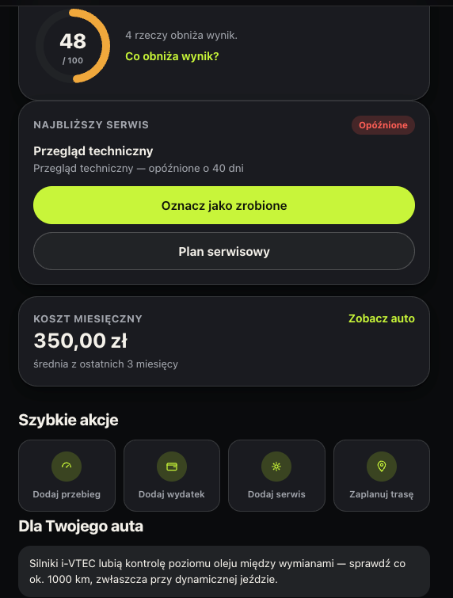

# apka dla kierowców

Garaż w telefonie. Historia auta zwykle jest rozrzucona po paragonach, notatkach i pamięci, a o wymianie oleju przypomina się dopiero kontrolka. Tu wszystko jest w jednym miejscu.

  
  

Co umie:

- serwis z przypomnieniami (po kilometrach albo po czasie, co jest pierwsze)
- wydatki i przebieg
- trasy i modyfikacje auta
- dodawanie auta po numerze VIN (marka, rocznik, silnik same się uzupełniają)
- asystent, który odpowiada na pytania w kontekście konkretnego auta i jego historii
- ranking kierowców i mapa warsztatów

## przypomnienia

Najciekawsza część logiki. Każde zadanie serwisowe ma interwał w km, w dniach albo w obu. Z historii przebiegu liczę, ile średnio jeździsz dziennie, i dzięki temu nawet przypomnienie ustawione tylko w kilometrach pokazuje "za około 40 dni". Jak termin jest bliżej niż 30 dni albo zostało mniej niż 10% interwału (minimum 1000 km), zadanie robi się pilne. Codziennie w tle leci zadanie, które to wszystko przelicza dla każdego auta.

## co jest w repo

Kilka plików, nie cała aplikacja:

- `lib/serwis.js` - liczenie terminów serwisu i opisów typu "za około 1 200 km lub 38 dni"
- `api/vin-decode.js` - endpoint do dekodowania VIN

## technologie

JavaScript, PostgreSQL, Alpine.js, API modelu AI do asystenta, PWA.

Więcej o mnie: [alex-rakowski.hatchable.site](https://alex-rakowski.hatchable.site)
