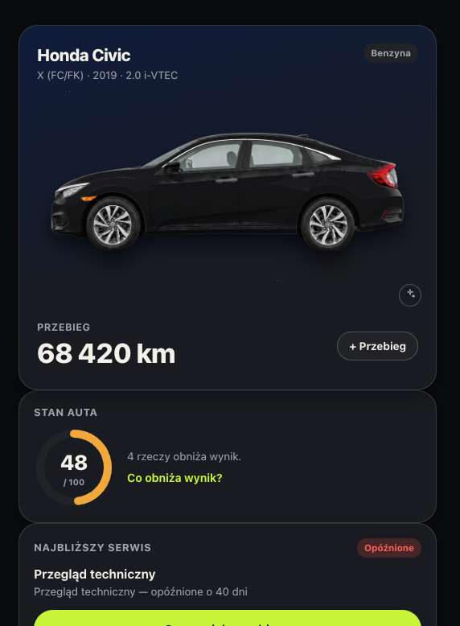

# apka dla kierowców

Garaż w telefonie. Historia auta zwykle jest rozrzucona po paragonach, notatkach i pamięci, a o wymianie oleju przypomina się dopiero kontrolka. Tu wszystko jest w jednym miejscu.

  
  

## funkcje

- ekran "dzisiaj" - auto, przebieg, ocena stanu auta od 0 do 100 z wyjaśnieniem, co ją obniża, najbliższy serwis i średni koszt miesięczny
- porady pod konkretne auto - krótkie wskazówki dopasowane do silnika i przebiegu
- garaż - kilka aut na jednym koncie i szybkie przełączanie między nimi
- dodawanie auta - krok po kroku (model, silnik, przebieg, kolor) albo z numeru VIN
- przebieg - historia wpisów z licznika
- plan serwisowy - zadania z interwałem w kilometrach albo w czasie, historia serwisów, oznaczanie jako zrobione i przypomnienia
- wydatki - wszystkie koszty auta i średnia miesięczna
- trasy - planowanie i zapisywanie tras
- modyfikacje - lista przeróbek, cele i kolejne etapy projektu auta
- kreacje AI - generowanie obrazków twojego auta
- asystent AI - pytasz o swoje auto, a on odpowiada, znając jego historię
- warsztaty - wyszukiwanie serwisów w okolicy
- ranking - porównanie z innymi kierowcami
- tryb demo z przykładowym autem, żeby obejrzeć apkę bez wpisywania danych
- logowanie kodem z maila, bez hasła

## przypomnienia

Najciekawsza część logiki. Każde zadanie serwisowe ma interwał w km, w dniach albo w obu. Z historii przebiegu liczę, ile średnio jeździsz dziennie, i dzięki temu nawet przypomnienie ustawione tylko w kilometrach pokazuje "za około 40 dni". Jak termin jest bliżej niż 30 dni albo zostało mniej niż 10% interwału (minimum 1000 km), zadanie robi się pilne. Codziennie w tle leci zadanie, które to wszystko przelicza dla każdego auta.

## co jest w repo

Kilka plików, nie cała aplikacja:

- `lib/serwis.js` - liczenie terminów serwisu i opisów typu "za około 1 200 km lub 38 dni"
- `api/vin-decode.js` - endpoint do dekodowania VIN

## technologie

JavaScript, PostgreSQL, Alpine.js, API modelu AI do asystenta, PWA.

Więcej o mnie: [alex-rakowski.hatchable.site](https://alex-rakowski.hatchable.site)
